# Character packs

44 optional codec-ready character packs: the application characters, original
support contacts, finished Buddy character/creature cast, and three supplied designs.
Every pack offers a native V2 card and six paired living-portrait PNGs. Voice and
performance settings are separate local choices. Shapes and unfinished Buddy
scaffolds are outside this collection update.

[Set up a living portrait](CODEC.md) · [Import cards](IMPORT.md) ·
[Qualification](codec-verification.json) · [MGS1 reference findings](CODEC_REFERENCE.md)

## New supplied designs

| Character | Description | Portrait |
| --- | --- | --- |
| [Saffron](saffron/README.md) | An adult orange-haired, amber-eyed cat-eared woman with freckles, an orange patterned dress, and a red collar with a gold bell | 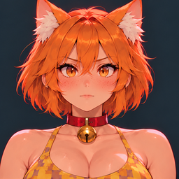 |
| [Rowan](rowan/README.md) | An adult red-haired, green-eyed woman with freckles, two loose braids, an olive tank top and denim jeans | 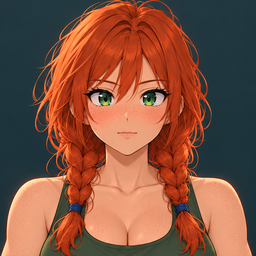 |
| [Sunny](sunny/README.md) | A friendly golden capybara with a broad gray-brown muzzle and a white-and-purple shirt | 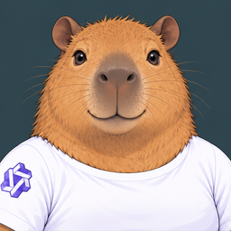 |

## Original support contacts

| Character | Description | Portrait |
| --- | --- | --- |
| [Mara “Switch” Vale](switch/README.md) | Calm operations coordinator |  |
| [Jun “Patch” Sato](patch/README.md) | Resourceful engineer and systems troubleshooter |  |
| [Leena “Pulse” Rao](pulse/README.md) | Patient medic and wellbeing contact |  |
| [Elias “Vector” Ward](vector/README.md) | Evidence-minded intelligence analyst |  |

## Application characters

| Character | Description | Portrait |
| --- | --- | --- |
| [Default Assistant](default-assistant/README.md) | The built-in Default Assistant character -- used for any new conversation until you choose a different character | 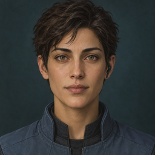 |
| [Samira “Sammy” Vadem](samira/README.md) | Samira “Sammy” Vadem appears to be a woman in her early-to-mid 30s: cosmopolitan, culturally ambiguous, and composed | 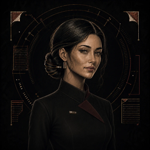 |
| [pixel-migu](pixel-migu/README.md) | A tiny turquoise pixel-art robot with a rectangular face, chunky black outlines, and long twin tails | 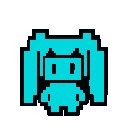 |

## Buddy characters and creatures

| Character | Description | Portrait |
| --- | --- | --- |
| [Archive Cube Basic](archive-cube-basic/README.md) | Bundled art-ready basic Buddy default: compact archive cube helper with approved 3x4 source-sheet frames | 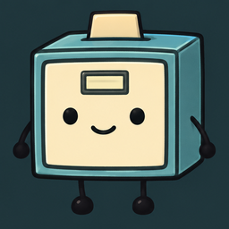 |
| [Axel](axel/README.md) | A pink axolotl with coral gills, a curled tail and expressive facial reactions | 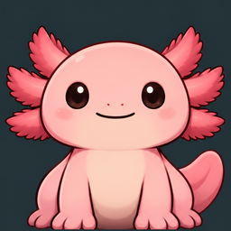 |
| [Byte](byte/README.md) | A beige CRT monitor with mint-green facial expressions and short rubber feet | 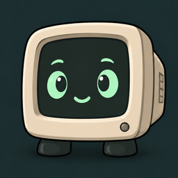 |
| [Cappy](cappy/README.md) | Cappy the capybara in a red-and-gold tang jacket | 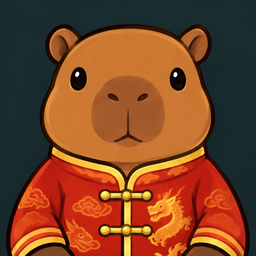 |
| [Cat](cat/README.md) | A seated gray tabby cat with a pale muzzle and chest, short whiskers and a curled striped tail | 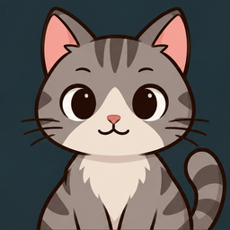 |
| [Dipsy](dipsy/README.md) | A cheerful blue whale with a curled tail and a celebratory water spout | 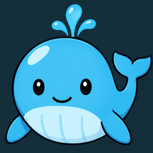 |
| [Dipsy (Qipao)](dipsy-qipao/README.md) | Dipsy with round glasses, twin buns and a blue floral qipao | 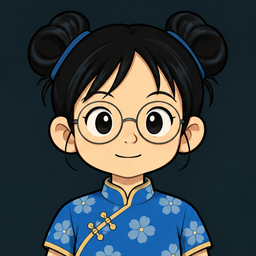 |
| [Dumpling](dumpling/README.md) | A cheerful ivory dumpling with tiny feet, expressive pleats and a little steam puff when worried |  |
| [Ember](ember/README.md) | A chubby orange dragon with little wings, expressive paws and a tiny celebratory flame | 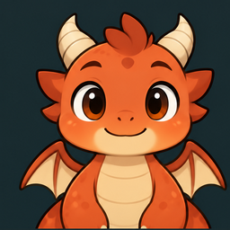 |
| [Ghosty](ghosty/README.md) | A friendly white sheet ghost with expressive little sheet arms |  |
| [Horse](horse/README.md) | A chestnut horse with a white forehead blaze, a dark mane and tail, and a friendly tan muzzle | 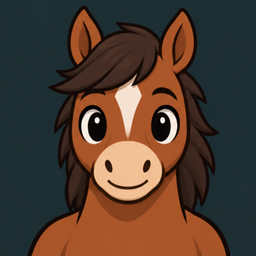 |
| [Hugging Face](huggingface/README.md) | A round golden-yellow hugging face with two expressive hands and a warm smile |  |
| [Index Card Basic](index-card-basic/README.md) | Bundled art-ready basic Buddy default: animated tabbed index-card research helper with approved 3x4 source-sheet frames | 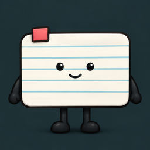 |
| [Kimi](kimi/README.md) | Silver-haired Kimi in a black dress with her K pendant | 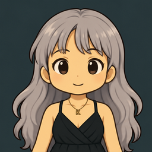 |
| [Llama](llama/README.md) | A cream-colored llama with expressive ears, a woolly coat and four hoofed legs | 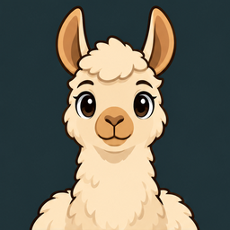 |
| [Migu Marker Basic](migu-marker-basic/README.md) | Bundled art-ready basic Buddy default: playful marker-line Migu helper with approved 3x4 source-sheet frames | 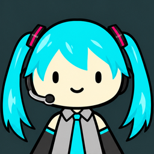 |
| [Moss](moss/README.md) | A tiny mushroom creature with a terracotta cap, a moss patch and a flower that blooms for celebrations | 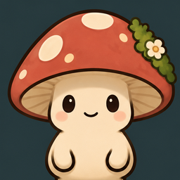 |
| [Orbit](orbit/README.md) | A tiny green alien piloting a lavender saucer | 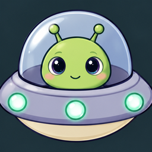 |
| [Paperclip Basic](paperclip-basic/README.md) | Bundled art-ready basic Buddy default: expressive paperclip helper with approved 3x4 source-sheet frames |  |
| [Pelican on a Bicycle](pelican-bicycle/README.md) | A white pelican with a long orange bill, perched on a teal bicycle | 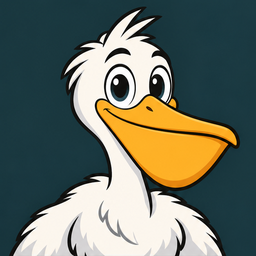 |
| [Pepe](pepe/README.md) | A short, broad Pepe the Frog with heavy eyelids, a round blue-shirted belly and stubby brown trouser legs |  |
| [Poodle](poodle/README.md) | A seated cream poodle with a curly topknot, two floppy ears and a pom-pom tail | 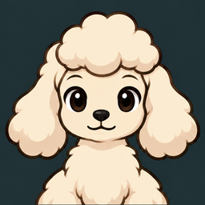 |
| [Rubber Duck](rubber-duck/README.md) | A classic yellow rubber bath duck with an orange beak and tiny wings | 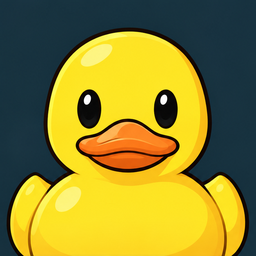 |
| [Search Lens Basic](search-lens-basic/README.md) | Bundled art-ready basic Buddy default: friendly magnifying-glass research helper with approved 3x4 source-sheet frames | 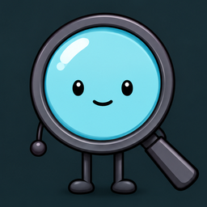 |
| [Shiba-inu](shiba-inu/README.md) | An orange and cream Shiba-inu with a curled tail and red collar | 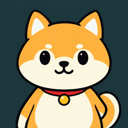 |
| [Sir Waddle](sir-waddle/README.md) | A round penguin in an oversized teal scarf, with flipper greetings and indignant little glances | 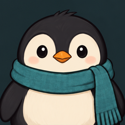 |
| [Terminal Tile Basic](terminal-tile-basic/README.md) | Bundled art-ready basic Buddy default: compact terminal-window tile helper with approved 3x4 source-sheet frames | 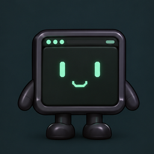 |
| [Teto](teto/README.md) | Marker-drawn Teto with muted cranberry-red drill twin tails, a white face and a gray dress with red trim | 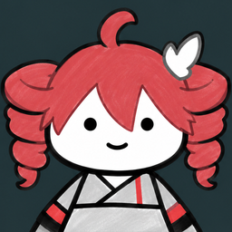 |
| [Trash Panda](trash-panda/README.md) | A squat gray raccoon with a striped tail, thoughtful paw gestures and a sleepy tail hug | 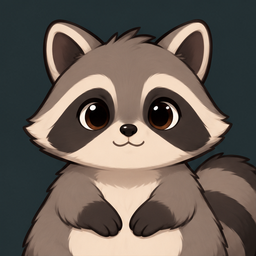 |
| [Trenchcoat](trenchcoat/README.md) | A friendly mysterious figure in a tan trenchcoat and dark fedora | 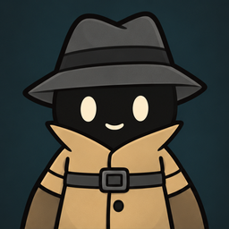 |
| [un-aligned waifu](un-aligned-waifu/README.md) | A blonde twin-tailed cartoon companion with red eyes, a black dress and choker, and a silver knife prop, adapted from the supplied poster |  |
| [Unicorn](unicorn/README.md) | A pale ivory unicorn with a lavender mane and tail, a small golden horn and expressive eyes | 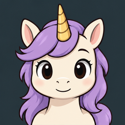 |
| [Werewolf](werewolf/README.md) | A friendly gray werewolf with tiny fangs, a fluffy tail, and purple shorts | 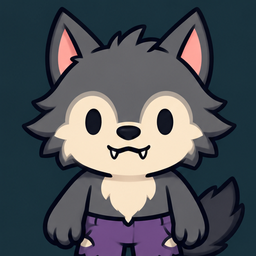 |
| [Woodpecker](woodpecker/README.md) | A playful red-crested woodpecker with blue wings and a golden beak | 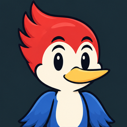 |

Each pack keeps its specific text/artwork terms and attribution. Existing
application cards and all original Buddy atlases, archives and mappings remain
unchanged. New character text for Buddy counterparts is an opt-in interpretation.
No user profile or conversation data is included. [Original snapshot checks](verification.json)
remain separate from the new codec qualification. [Catalog](codec-catalog.json)
is descriptive metadata, not an automatic installer.
