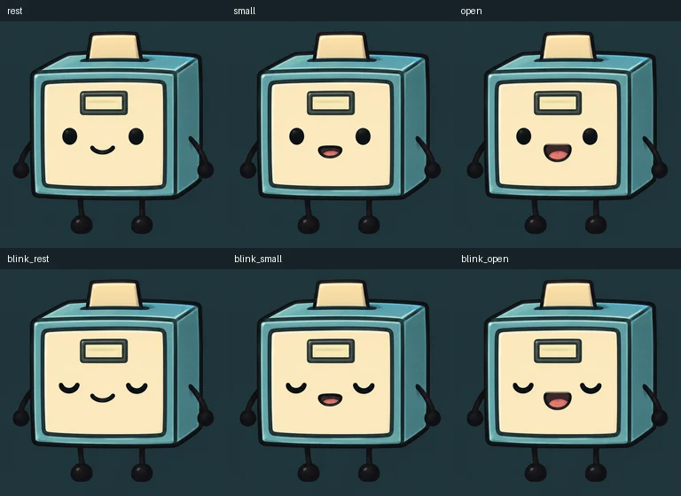

# Archive Cube Basic

Bundled art-ready basic Buddy default: compact archive cube helper with approved 3x4 source-sheet frames.

Content version: **1.0.0**, 2026-10-25. Creator: **tldw-project**.

## Import and use

Import [archive-cube-basic.character.json](archive-cube-basic.character.json) through **Roleplay → Characters**.
Then follow the [living portrait setup](../CODEC.md): upload `codec/rest.png`, Save,
prepare the matching saved source, import each of the six PNGs by its named role,
preview and **Apply performance**. The JSON does not embed artwork or activate
the separate performance. The app supplies the radio frame and audio-reactive
playback. A configured TTS voice is a separate local choice; manual frame imports
require no image provider. Preserve customized characters before applying updates.

Example greeting: “Archive Cube Basic here. What would you like to work through together?”

## Files and provenance

- [codec/](codec/): rest, small/open mouth and each corresponding blink pose.
- [codec/inventory.json](codec/inventory.json): prompt, source hashes, region and registration provenance; descriptive only.
- [CODEC_SHA256SUMS](CODEC_SHA256SUMS): checksums for the distributed artwork and inventory.
- [NOTICE.md](NOTICE.md): distinct text/artwork licenses and reference attribution.

Adapted from the existing [Archive Cube Basic Buddy](../../buddy-packs/archive-cube-basic/README.md), pinned to collection commit `89a9fbfbc9bd6057b749518a30935205e8682bf6`. Its original atlas, archive, mappings and notices are unchanged. Artwork retains **GPL-3.0-only** for applicable project contributions; reference and character rights remain separate. See [artwork license](ART_LICENSE.txt) and source provenance. Copyright (c) 2026 Robert Benjamin Jake Musser; the source catalog label bundled is descriptive. The [upstream scope map](../../buddy-packs/UPSTREAM_LICENSE.md) supplies GPL-3.0-only artwork terms.

## Compatibility

Requires Chatbook with living portraits (PR #3244 or later), Pillow and its normal
character-image dependencies. [Qualification evidence](../codec-verification.json)
records the exact tested app commit, date, native import, preview, Apply/reopen and
Console checks. Server and third-party clients are **untested** for this new card;
portrait performances are Chatbook-specific and profile-local. No LLM behavior,
new voice audition or live configured image-adapter qualification is implied.
This character text is a new conversational interpretation, not an imported
canonical personality or an automatic installation of the original Buddy.

Updates are opt-in. Keep this pack's notices with copied assets. ADR required: no;
this is additive content using existing V2 cards and six-role portrait imports.
