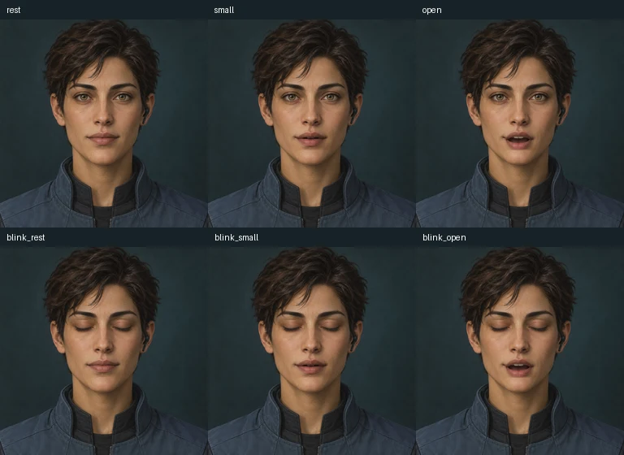

# Default Assistant

The built-in general-purpose character, preserved as separate application defaults.

| File | Source and behavior | License |
| --- | --- | --- |
| [chatbook.character.json](chatbook.character.json) | Chatbook's enriched example card, including personality, system prompt, detailed greeting, and alternate greetings | [AGPL-3.0-or-later](../../LICENSES/AGPL-3.0-or-later.txt) |
| [server.character.json](server.character.json) | Server's minimal general-purpose card and greeting, with no added system prompt | [GPL-3.0-only](SERVER_LICENSE.txt) |

Content version: **1.0.1**, exported from fresh temporary databases on 2026-09-05.
Neither JSON variant embeds artwork or a voice profile. Optional codec artwork is supplied separately below. Choose the variant you want;
they have the same character name but different original content.

## Use and verification

Follow the [character import guide](../IMPORT.md). Both JSON variants passed
Chatbook's native file import into new records after renaming the pre-existing
default in an isolated database. The server variant also passed the actual
server import endpoint function and persisted-field checks. Live UI/model
behavior and the enriched Chatbook variant on the server were not tested.

Updates are separate downloads. Preserve any customized card before importing,
and do not assume an import changes your active/default character selection.

## Provenance

Creator metadata is **tldw-project** in both downloadable cards.

- [Chatbook database seed](https://github.com/rmusser01/tldw_chatbook/blob/56376e1fc188938bf350c62d3a9f95e820b93c40/tldw_chatbook/DB/ChaChaNotes_DB.py), exported using `export_character_card_to_json` from a fresh row 1.
- [Server database seed](https://github.com/rmusser01/tldw_server/blob/36b846628d7755e91e0d5539740a9f5c9a837966/tldw_Server_API/app/core/DB_Management/ChaChaNotes_DB.py), exported using the native `export_character(format="v2", include_world_books=False)` operation.

Native exporters normalize database null text values to empty strings. No
prompts or greetings were rewritten. Server material retains its
[upstream scope](https://github.com/rmusser01/tldw_server/blob/36b846628d7755e91e0d5539740a9f5c9a837966/LICENSE)
and required notice: Copyright (c) 2026 Robert Benjamin Jake Musser.

## Collection creator

Creator: **tldw-project**. The 2026-09-07 update changes creator metadata only;
prompts, reactions, artwork pixels and source-license notices retain their prior
content. [Metadata changes and checksums](../creator-metadata.json) record the
previous source hashes and updated distributed hashes. Earlier import results
describe the original snapshot; this update was checked for metadata-only changes.

## Optional codec portrait — artwork version 1.0.0

The 2026-10-25 collection update adds [six ready-made living portrait frames](codec/)
and a [checksum/provenance inventory](codec/inventory.json). Existing cards,
prompts, artwork and expression mappings are preserved. Follow the
[codec setup guide](../CODEC.md); these files do not activate themselves when
the card is imported. Duplicate customized characters before changing their
local artwork. Use `codec/rest.png` as the source for this specific performance.

See [qualification evidence](../codec-verification.json) for tested Chatbook
commit and scope. Server performance imports are not supported; no new server
or third-party qualification is claimed. A voice remains a separate local choice.

The optional original operator portrait uses Apache-2.0 for AI-assisted project
contributions to the extent applicable; both JSON cards retain their existing
AGPL/GPL terms. Creator: **tldw-project**. The original artwork was made with
built-in ChatGPT image generation, then source-preserving local composition.
