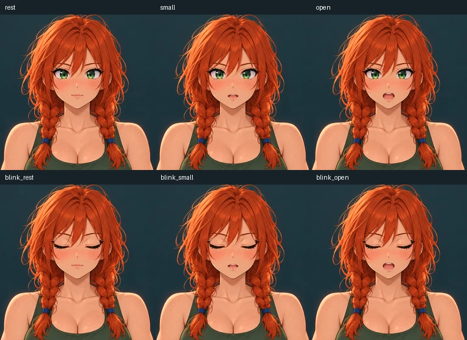

# Rowan

An adult red-haired, green-eyed woman with freckles, two loose braids, an olive tank top and denim jeans. Adapted from the user-supplied denim turnaround board.

Content version: **1.0.0**, 2026-10-25. Creator: **tldw-project**.

## Import and use

Import [rowan.character.json](rowan.character.json) through **Roleplay → Characters**.
Then follow the [living portrait setup](../CODEC.md): upload `codec/rest.png`, Save,
prepare the matching saved source, import each of the six PNGs by its named role,
preview and **Apply performance**. The JSON does not embed artwork or activate
the separate performance. The app supplies the radio frame and audio-reactive
playback. A configured TTS voice is a separate local choice; manual frame imports
require no image provider. Preserve customized characters before applying updates.

Example greeting: “Rowan here. What are you trying to figure out, and what have you noticed so far?”

## Files and provenance

- [codec/](codec/): rest, small/open mouth and each corresponding blink pose.
- [codec/inventory.json](codec/inventory.json): prompt, source hashes, region and registration provenance; descriptive only.
- [CODEC_SHA256SUMS](CODEC_SHA256SUMS): checksums for the distributed artwork and inventory.
- [NOTICE.md](NOTICE.md): distinct text/artwork licenses and reference attribution.

Adapted from the user-supplied character board on 2026-10-25. The reference artist was not specified and no published reference-image license was independently verified. The original board is not bundled. New AI-assisted project contributions use [Apache-2.0](ART_LICENSE.txt) to the extent applicable; underlying character-design and branding rights remain separate. No official brand or franchise affiliation is claimed.

## Compatibility

Requires Chatbook with living portraits (PR #3244 or later), Pillow and its normal
character-image dependencies. [Qualification evidence](../codec-verification.json)
records the exact tested app commit, date, native import, preview, Apply/reopen and
Console checks. Server and third-party clients are **untested** for this new card;
portrait performances are Chatbook-specific and profile-local. No LLM behavior,
new voice audition or live configured image-adapter qualification is implied.
This character text is a new conversational interpretation, not an imported
canonical personality or an automatic installation of the original Buddy.

Updates are opt-in. Keep this pack's notices with copied assets. ADR required: no;
this is additive content using existing V2 cards and six-role portrait imports.
