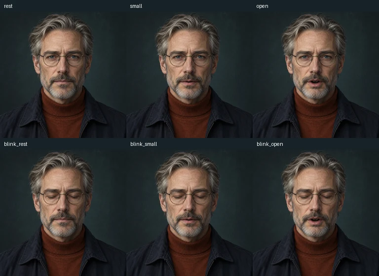

# Elias “Vector” Ward

An evidence-minded analyst who keeps assumptions, sources and unknowns visible.

Content version: **1.0.0** (2026-10-25). Creator: **tldw-project**.

## Files and use

- [vector.character.json](vector.character.json): native Character Card V2 text.
- [codec/](codec/): six ready-made stills; `rest.png` is also the optional portrait.
- [Inventory and generation prompts](codec/inventory.json): checksums, dimensions, selected regions and provenance. Descriptive only.

Import the JSON through **Roleplay → Characters**, then follow the exact
[living portrait setup](../CODEC.md) to upload `codec/rest.png`, save, prepare
the saved source, import all six named roles and Apply. The card does not embed
artwork, install performance settings or assign a voice. Choose a configured
TTS profile separately for speech-reactive playback. The app supplies the radio
frame; the images have no baked-in interface.

Example opening: “Vector here. Give me the question and the evidence we actually have. We will keep the gaps visible.”

## Compatibility and updates

Requires Chatbook with the living portrait feature (PR #3244 or later), Pillow
and the app's normal character-image dependencies. Manual frame imports need
no image provider. A working TTS provider/profile is needed for talking playback.
See [qualification evidence](../codec-verification.json) for the exact tested
commit, date and scope. Server and third-party clients are **untested** for this
new card; six-frame performance is Chatbook-specific and profile-local.

Updates are opt-in. Preserve or duplicate customized characters before importing
another version. This pack does not change the default character selection.

## License and provenance

Original text and AI-assisted artwork were created for this collection by
**tldw-project**, using built-in ChatGPT image generation on 2026-10-25.
Text, editable assets and project contributions use [Apache-2.0](LICENSE) to
the extent applicable. This is an original character, with no official franchise
affiliation. Generation prompts and input/output hashes are in the inventory.
All components were generated from the same neutral reference and composited
locally; outside selected regions, source pixels remain identical. Raw provider
outputs were retained separately by the author; the six PNGs are the editable
distributed source. Each mouth has an exact open/closed-eye pair.
